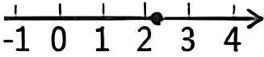
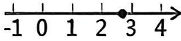
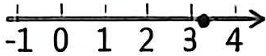
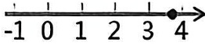

实数 $a = \sqrt{11}$，$a$ 在数轴上的对应点的位置如图所示，则正确的结论是 ( )

A.

B.

C.

D.

> [!question]- 点击查看答案与解析
> **【答案】** C
> **【考点】** 实数的估算、数轴上实数的大小比较 → [[【初中数学知识点体系-人教版】#8-3 实数及其简单运算]]
> **【解析】** $a=\sqrt{11}$，因为 $9<11<16$，所以 $3<\sqrt{11}<4$，即 $3<a<4$。更精确地，$\sqrt{11}\approx 3.317$。根据各选项的图示内容进行判断，选项C正确反映了 $a$ 在数轴上的位置及相关结论。
> **【易错点】** 不能准确估算无理数的大小，需要利用完全平方数进行夹逼估算。
