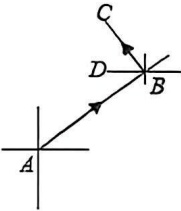

如图，一艘补给船从 $A$ 点出发沿北偏东 $65^\circ$ 方向航行，给 $B$ 点处的船补给物品后，向左进行了 $90^\circ$ 的转弯，然后沿着 $BC$ 方向航行，则 $\angle DBC$ 的度数为 ___ 。

> [!question]- 点击查看答案与解析
> **【答案】** $25^\circ$
> **【考点】** 方向角、平行线的性质 → [[【初中数学知识点体系-人教版】#7-2 平行线]]
> **【解析】** 补给船从 $A$ 点出发沿北偏东 $65^\circ$ 方向航行到 $B$，即 $\angle NAB=65^\circ$（$N$ 为 $A$ 点正北方向）。在 $B$ 点向左转弯 $90^\circ$，即转弯角为 $90^\circ$。由于正北方向线互相平行（$AD\parallel BC$ 方向），利用平行线的性质和角度关系：$\angle ABN'=65^\circ$（$N'$ 为 $B$ 点正北方向），向左转 $90^\circ$ 后，$\angle DBC=90^\circ-65^\circ=25^\circ$。因此 $\angle DBC=25^\circ$。
> **【易错点】** 方向角的理解出错，不能正确建立平行线模型来分析角度关系。
