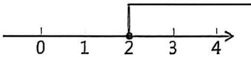

若关于 x 的不等式 $x - n \geq -1$ 的解集如图所示，则 n 等于 ___ .

> [!question]- 点击查看答案与解析
> **【答案】** $2$
> **【考点】** 一元一次不等式的解集、数轴上解集的表示 → [[【初中数学知识点体系-人教版】#11-2 一元一次不等式]]
> **【解析】** 解不等式 $x-n\geq -1$：$x\geq n-1$。根据数轴上的解集图示，解集为 $x\geq 1$（从图中可读出不等式的解集起点为 $1$，且包含端点）。所以 $n-1=1$，解得 $n=2$。
> **【易错点】** 不能正确从数轴上读取不等式的解集信息，或解不等式时移项出错。
