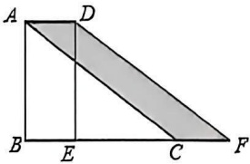

如图，在三角形 $ABC$ 中，$\angle B = 90^{\circ}$，$AB = 8$。将三角形 $ABC$ 沿着 $BC$ 的方向平移至三角形 $DEF$，若平移的距离是 4，则图中阴影部分的面积为 ___ .

> [!question]- 点击查看答案与解析
> **【答案】** $32$
> **【考点】** 平移的性质、梯形面积 → [[【初中数学知识点体系-人教版】#7-4 平移]]
> **【解析】** 三角形 $ABC$ 沿 $BC$ 方向平移至三角形 $DEF$，平移距离为 $4$。由平移性质，$BE=CF=4$（平移距离），$AB=DE=8$，$AB\parallel DE$。阴影部分为梯形 $ABEH$（其中 $H$ 为 $DE$ 与 $AC$ 的交点，根据图形确定）。实际上，阴影部分是一个梯形，其上底和下底分别为平移前后三角形的对应边的一部分，高为平移距离。由平移性质，阴影部分面积 $=AB\times$ 平移距离 $=8\times 4=32$。
> **【易错点】** 不能正确识别阴影部分的形状，忽视平移性质中对应线段平行且相等的特征。
