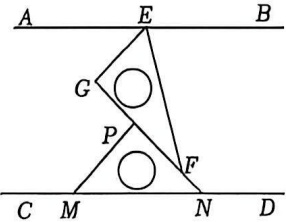

在数学课上，小明提出如下命题："在同一平面内，如果直线 $l_1$，$l_2$ 相交于 $P$，且 $l_1 \parallel l$，那么 $l_2$ 与 $l$ 一定相交。"同学们，你认为小明提出的命题是 ___ （填"真命题"或"假命题"），你的依据是：___ 。

> [!question]- 点击查看答案与解析
> **【答案】** 真命题；同一平面内，过直线外一点有且只有一条直线与已知直线平行（平行公理）
> **【考点】** 平行公理、真命题与假命题 → [[【初中数学知识点体系-人教版】#7-3 定义、命题、定理]]
> **【解析】** 命题条件：在同一平面内，$l_1$ 与 $l_2$ 相交于 $P$，且 $l_1\parallel l$。由 $l_1\parallel l$ 知 $l_1$ 与 $l$ 不相交。又 $l_1$ 与 $l_2$ 相交于 $P$，说明 $P$ 在 $l_1$ 上但不在 $l$ 上。关键依据：在同一平面内，如果 $l_2$ 与 $l$ 不相交（即 $l_2\parallel l$），又因为 $l_1\parallel l$，则 $l_2\parallel l_1$。但这与已知 $l_1$ 与 $l_2$ 相交矛盾。所以 $l_2$ 与 $l$ 一定相交。命题为真命题。依据是平行公理的推论：同一平面内，平行于同一条直线的两条直线互相平行。若 $l_2\parallel l$ 且 $l_1\parallel l$，则 $l_2\parallel l_1$，与 $l_1$、$l_2$ 相交矛盾。
> **【易错点】** 不能正确运用反证法或平行公理的推论来分析命题的真假。
