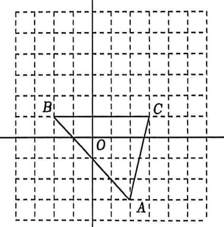

如图，已知点A和点B的坐标分别为 $(2,-3)$ 和 $(-2,1)$

（1）在图中建立适当的平面直角坐标系：

（2）点 C 的坐标为 ___ ；

（3）网格中存在格点 $D$，使得 $\triangle CBD \cong \triangle BCA$，请写出所有符合条件的点 $D$ 的坐标。

> [!question]- 点击查看答案与解析
> **【答案】** （2）$C(-2,-3)$；（3）$D$ 的坐标为 $(-2,-1)$ 或 $(2,1)$ 或 $(-6,-3)$
> **【考点】** 平面直角坐标系的建立、全等三角形的性质 → [[【初中数学知识点体系-人教版】#9-1 用坐标描述平面内点的位置]]、[[【初中数学知识点体系-人教版】#14-1 全等三角形及其性质]]
> **【解析】** （1）根据点 $A(2,-3)$ 和 $B(-2,1)$ 的坐标，在网格图中找到合适的位置建立坐标系，使 $A$、$B$ 两点坐标满足已知条件。（2）根据建立的坐标系和网格图，读出点 $C$ 的坐标为 $(-2,-3)$。（3）要使 $\triangle CBD\cong\triangle BCA$，需要 $CB=CB$（公共边），$BD=BA$，$CD=CA$。$BA=\sqrt{(2-(-2))^2+(-3-1)^2}=\sqrt{16+16}=\sqrt{32}=4\sqrt{2}$，$CA=\sqrt{(2-(-2))^2+(-3-(-3))^2}=\sqrt{16}=4$，$CB=\sqrt{(-2-(-2))^2+(-3-1)^2}=\sqrt{16}=4$。利用全等三角形的对应关系，在网格中找出所有满足条件的格点 $D$，分别计算其坐标。
> **【易错点】** 建立坐标系时原点位置选取不当；求全等三角形的对应点时遗漏某些情况。
