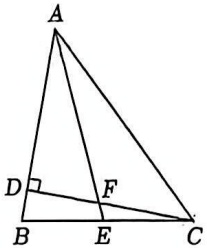

如图，$CD$ 是 $\triangle ABC$ 的高线，$E$ 为 $BC$ 边上的一点，连接 $AE$ 交 $CD$ 于点 $F$，$\angle BCD = 10^\circ$，$\angle AEB = 75^\circ$。

（1）求 $\angle BAE$ 的度数：

（2）若 $AE$ 平分 $\angle BAC$，求 $\angle ACD$ 的度数。

> [!question]- 点击查看答案与解析
> **【答案】** （1）$\angle BAE=25^\circ$；（2）$\angle ACD=40^\circ$
> **【考点】** 三角形内角和定理、三角形外角性质、角平分线 → [[【初中数学知识点体系-人教版】#13-3 三角形的内角与外角]]
> **【解析】** （1）因为 $CD$ 是 $\triangle ABC$ 的高线，所以 $\angle CDB=\angle CDA=90^\circ$。在 $\triangle BCD$ 中，$\angle BDC=90^\circ$，$\angle BCD=10^\circ$，所以 $\angle B=180^\circ-90^\circ-10^\circ=80^\circ$。在 $\triangle ABE$ 中，$\angle AEB=75^\circ$，$\angle B=80^\circ$，所以 $\angle BAE=180^\circ-75^\circ-80^\circ=25^\circ$。（2）若 $AE$ 平分 $\angle BAC$，则 $\angle BAE=\angle CAE=25^\circ$，$\angle BAC=50^\circ$。在 $\triangle ABC$ 中，$\angle B=80^\circ$，$\angle BAC=50^\circ$，$\angle ACB=180^\circ-80^\circ-50^\circ=50^\circ$。因为 $\angle BCD=10^\circ$，$\angle ACD=\angle ACB-\angle BCD=50^\circ-10^\circ=40^\circ$。
> **【易错点】** 不能正确利用高线构造直角三角形来求角；角平分线条件的运用不熟练。
