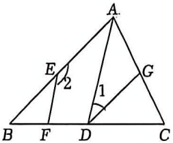

如图，在 $\triangle ABC$ 中，$AB \parallel DG$，$\angle 1+\angle 2=180^\circ$。

（1）求证：$AD \parallel EF$；

（2）若 $DG$ 是 $\angle ADC$ 的平分线，$\angle 2 = 150^\circ$，求 $\angle B$ 的度数。

> [!question]- 点击查看答案与解析
> **【答案】** （1）证明见解析；（2）$\angle B=30^\circ$
> **【考点】** 平行线的判定与性质、角平分线、三角形内角和 → [[【初中数学知识点体系-人教版】#7-2 平行线]]、[[【初中数学知识点体系-人教版】#13-3 三角形的内角与外角]]
> **【解析】** （1）证明：因为 $AB\parallel DG$，所以 $\angle BAD=\angle ADG$（两直线平行，内错角相等）。由图可知，$\angle 1=\angle BAD$，$\angle 2$ 与 $\angle ADC$ 互补，即 $\angle 2+\angle ADC=180^\circ$。又 $\angle 1+\angle 2=180^\circ$，所以 $\angle 1=\angle ADC$。因为 $\angle 1=\angle BAD=\angle ADG$，所以 $\angle ADG=\angle ADC$。因此 $AD\parallel EF$（同位角相等，两直线平行）。（2）因为 $\angle 1+\angle 2=180^\circ$，$\angle 2=150^\circ$，所以 $\angle 1=30^\circ$。因为 $\angle 1=\angle BAD$（已证），所以 $\angle BAD=30^\circ$。因为 $AB\parallel DG$，所以 $\angle ADG=\angle BAD=30^\circ$（内错角相等）。因为 $DG$ 平分 $\angle ADC$，所以 $\angle ADC=2\angle ADG=2\times 30^\circ=60^\circ$。在 $\triangle ABD$ 中，$\angle ADB=180^\circ-\angle ADC=180^\circ-60^\circ=120^\circ$（$D$ 在 $BC$ 上，$\angle ADB$ 与 $\angle ADC$ 互补）。由三角形内角和定理：$\angle B=180^\circ-\angle BAD-\angle ADB=180^\circ-30^\circ-120^\circ=30^\circ$。因此 $\angle B=30^\circ$。
> **【易错点】** 平行线的性质（内错角、同位角、同旁内角）运用混乱；不能正确识别角的互补关系和三角形内角和定理的应用。
