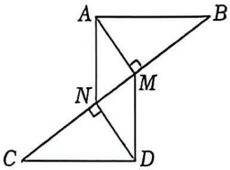

如图，在$\triangle ABN$ 和$\triangle DCM$ 中，点$C$、$N$、$M$、$B$ 在一条直线上，$AB = DC$，$AM \perp BC$ 于点$M$，$DN \perp BC$ 于点$N$，$CM = BN$．求证：$\angle B = \angle C$．

> [!question]- 点击查看答案与解析
> **【答案】** 证明见解析
> **【考点】** 全等三角形的判定与性质（HL定理或SAS） → [[【初中数学知识点体系-人教版】#14-2 三角形全等的判定]]
> **【解析】** 证明：因为 $AM\perp BC$，$DN\perp BC$，所以 $\angle AMB=\angle DNC=90^\circ$。因为 $CM=BN$，所以 $CM+MN=BN+MN$，即 $CN=BM$。在 $\triangle ABM$ 和 $\triangle DCN$ 中：$AB=DC$（已知），$BM=CN$（已证），$\angle AMB=\angle DNC=90^\circ$，所以 $\triangle ABM\cong\triangle DCN$（SAS）。因此 $\angle B=\angle C$。
> **【易错点】** 不能正确由 $CM=BN$ 推导出 $BM=CN$；全等三角形的判定条件选取不当。
