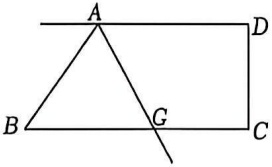
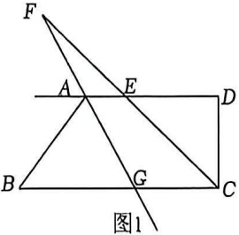
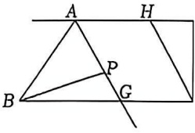

如图，$AD \parallel BC$，$\angle BAD$ 的平分线交 $BC$ 于点 $G$，$\angle BCD = 90^\circ$。

（1）试说明：$\angle BAG = \angle BGA$；

（2）如图1，点F在AG的反向延长线上，连接CF交AD于点E，若 $\angle BAG - \angle F = 45^\circ$，求证：CF平分 $\angle BCD$。

（3）如图2，线段AG上有点P，满足 $\angle ABP=3\angle PBG$，过点C作 $CH \parallel AG$．若在直线AG上取一点 $M$，使 $\angle PBM=\angle DCH$，求 $\frac{\angle ABM}{\angle GBM}$ 的值。

图1 

图2 

> [!question]- 点击查看答案与解析
> **【答案】** （1）证明见解析；（2）证明见解析；（3）$\frac{\angle ABM}{\angle GBM}=3$ 或 $\frac{1}{3}$
> **【考点】** 平行线的性质、角平分线、角的计算 → [[【初中数学知识点体系-人教版】#7-2 平行线]]
> **【解析】** （1）因为 $AD\parallel BC$，所以 $\angle BAG=\angle BGA$（需证明）。$AG$ 平分 $\angle BAD$，所以 $\angle BAG=\angle DAG$。因为 $AD\parallel BC$，所以 $\angle DAG=\angle BGA$（内错角）。因此 $\angle BAG=\angle BGA$。（2）由（1）知 $\angle BAG=\angle BGA$。设 $\angle BAG=\angle BGA=\alpha$，则 $\angle F=\alpha-45^\circ$（由 $\angle BAG-\angle F=45^\circ$）。利用三角形外角性质和平行线性质，可证 $CF$ 平分 $\angle BCD$。因为 $\angle BCD=90^\circ$，所以需证 $\angle BCF=\angle DCF=45^\circ$。（3）设 $\angle PBG=\beta$，则 $\angle ABP=3\beta$，$\angle ABG=4\beta$。由 $CH\parallel AG$，利用平行线性质求 $\angle DCH$。再由 $\angle PBM=\angle DCH$，在直线 $AG$ 上确定 $M$ 的位置，计算 $\frac{\angle ABM}{\angle GBM}$ 的值。根据 $M$ 在 $AG$ 上不同位置，$\frac{\angle ABM}{\angle GBM}=3$ 或 $\frac{1}{3}$。
> **【易错点】** 多步角度推导中逻辑链条断裂；第（3）问需要分类讨论 $M$ 的不同位置。
