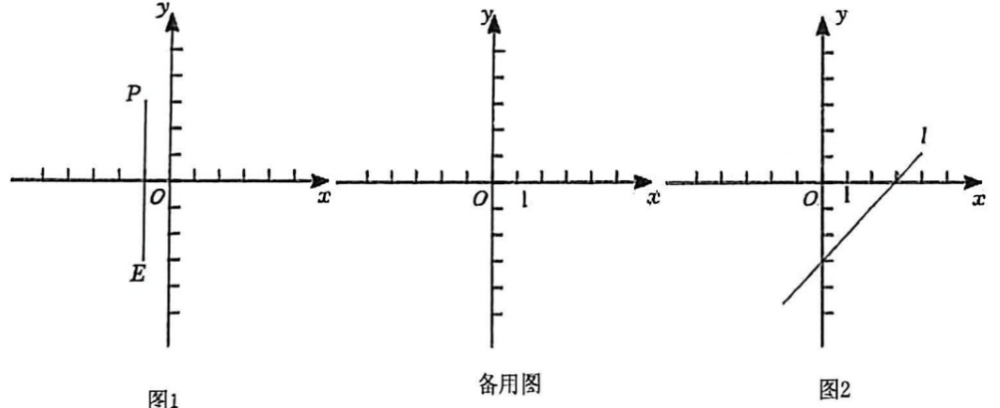

在平面直角坐标系 xOy 中，对于任意一点 $A(x,y)$，定义点 A 的"离心值" $p(A)$：

$$p(A)=\left\{\begin{aligned}&|x|, 当 |x|\geqslant|y| 时 \\ &|y|, 当 |x|<|y| 时 \end{aligned}\right.$$

例如对于点 $A(-6,3)$，因为 $|-6| > |3|$，所以 $p(A) = |-6| = 6$

（1）已知 $B(0,5)$，$C(-3,3)$，$D(-\sqrt{2}, -1)$，将 $p(B)$、$p(C)$、$p(D)$ 按从小到大的顺序排列（用"<"连接）___。

（2）如图1，点 $P(-1,3)$，$E(-1,-3)$，线段 PE 上的点 $M(x,y)$，

$①$ 若 $p(M)=1.5$，写出 M 的坐标。

$②$ 在图中画出满足 $p(M)=1$ 的点 M 组成的图形。

（3）如图2，直线 $l$ 过点 $(0,-3)$ 和 $(3,0)$，将直线 $l$ 向上平移 $m(m>0)$ 个单位得到直线 $l'$，若 $l'$ 上恰好有两个点的离心值为1，直接写出 $m$ 的取值范围。

> [!question]- 点击查看答案与解析
> **【答案】** （1）$p(D)<p(C)<p(B)$；（2）$①$ $M(-1,1.5)$ 或 $M(-1,-1.5)$；$②$ 见解析；（3）$1<m<5$
> **【考点】** 新定义运算、绝对值、平面直角坐标系、一次函数图象的平移 → [[【初中数学知识点体系-人教版】#8-3 实数及其简单运算]]、[[【初中数学知识点体系-人教版】#9-1 用坐标描述平面内点的位置]]
> **【解析】** （1）计算各点的离心值：$B(0,5)$：$|x|=0$，$|y|=5$，因为 $|x|<|y|$，所以 $p(B)=|y|=5$。$C(-3,3)$：$|x|=3$，$|y|=3$，因为 $|x|\geqslant|y|$，所以 $p(C)=|x|=3$。$D(-\sqrt{2},-1)$：$|x|=\sqrt{2}\approx 1.414$，$|y|=1$，因为 $|x|>|y|$，所以 $p(D)=|x|=\sqrt{2}\approx 1.414$。所以 $p(D)<p(C)<p(B)$。（2）$P(-1,3)$，$E(-1,-3)$，线段 $PE$ 上的点 $M(x,y)$ 满足 $x=-1$，$-3\leq y\leq 3$。$①$ $p(M)=1.5$：$|x|=1$，$|y|$ 的值待定。因为 $|x|=1<1.5$，所以 $p(M)=|y|=1.5$，即 $y=1.5$ 或 $y=-1.5$。所以 $M(-1,1.5)$ 或 $M(-1,-1.5)$。$②$ $p(M)=1$：$|x|=1$，若 $|x|\geqslant|y|$，则 $p(M)=|x|=1$，此时 $|y|\leqslant 1$，即 $-1\leq y\leq 1$。若 $|x|<|y|$，则 $p(M)=|y|=1$，此时 $|y|>|x|$，即 $|y|>1$，但 $|y|=1$ 不满足 $|y|>1$，矛盾。所以满足 $p(M)=1$ 的点为 $M(-1,y)$，其中 $-1\leq y\leq 1$，即线段 $PE$ 上从 $(-1,-1)$ 到 $(-1,1)$ 的一段。（3）直线 $l$ 过 $(0,-3)$ 和 $(3,0)$，斜率为 $\frac{0-(-3)}{3-0}=1$，直线 $l$：$y=x-3$。向上平移 $m$ 个单位得 $l'$：$y=x-3+m$。离心值为 $1$ 的点满足 $\max(|x|,|y|)=1$，即这些点组成一个边长为 $2$ 的正方形边界（顶点为 $(1,1)$、$(-1,1)$、$(-1,-1)$、$(1,-1)$）。直线 $l'$ 与该正方形边界恰好有两个交点时，求 $m$ 的取值范围。将 $y=x-3+m$ 代入正方形边界条件分析：当直线经过正方形的顶点时：过 $(1,1)$：$1=1-3+m$，$m=3$；过 $(-1,1)$：$1=-1-3+m$，$m=5$；过 $(-1,-1)$：$-1=-1-3+m$，$m=3$；过 $(1,-1)$：$-1=1-3+m$，$m=1$。分析直线与正方形恰好有两个交点的条件：当 $1<m<5$ 时，直线与正方形边界恰好有两个交点。
> **【易错点】** 新定义"离心值"的理解不到位；第（3）问中直线平移后与正方形边界交点个数的讨论较为复杂，需要分类分析。
