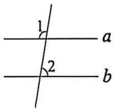

如图，已知直线 $a \parallel b$，$\angle 1 = 100^{\circ}$，则 $\angle 2$ 等于 ( )

A. $60^{\circ}$

B. $70^{\circ}$

C. $80^{\circ}$

D. $100^{\circ}$

> [!question]- 点击查看答案与解析
> **【答案】** C
> **【考点】** 平行线的性质 → [[【初中数学知识点体系-人教版】#7-2 平行线]]
> **【解析】** 如图，已知直线 $a \parallel b$"，$\angle 1=100^{\circ}$。由图可知，$\angle 1$ 与 $\angle 2$ 不在同一侧，$\angle 1$ 的邻补角与 $\angle 2$ 构成同位角关系。$\angle 1$ 的邻补角 $=180^{\circ}-100^{\circ}=80^{\circ}$。因为 $a \parallel b$，由同位角相等，可得 $\angle 2=80^{\circ}$。
> **【易错点】** 不能准确识别 $\angle 1$ 与 $\angle 2$ 的位置关系，需要利用邻补角、对顶角等中间角进行转化。
