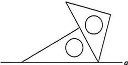
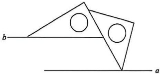
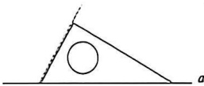
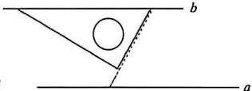

数学课上，老师要求同学们利用三角板画两条平行线．老师说苗苗和小华两位同学画法都是正确的，两位同学的画法如下：

苗苗的画法：

$①$ 将含 $30^{\circ}$ 角的三角尺的最长边与直线 a 重合，另一块三角尺最长边与含 $30^{\circ}$ 角的三角尺的最短边紧贴：

$②$ 将含 $30^{\circ}$ 角的三角尺沿贴合边平移一段距离，画出最长边所在直线 b，则 b//a. 小华的画法：

$①$ 将含 $30^{\circ}$ 角三角尺的最长边与直线 a 重合，用虚线做出一条最短边所在直线；

$②$ 再次将含 $30^{\circ}$ 角三角尺的最短边与虚线重合，画出最长边所在直线 b，则 b//a.

请在苗苗和小华两位同学画平行线的方法中选出你喜欢的一种，并写出这种画图的依据.

答：我喜欢 ___ 同学的画法，画图的依据是 ___ 。

> [!question]- 点击查看答案与解析
> **【答案】** 苗苗；同位角相等，两直线平行（或小华；内错角相等，两直线平行）
> **【考点】** 平行线的判定 → [[【初中数学知识点体系-人教版】#7-2 平行线]]
> **【解析】** 苗苗的画法依据：将两块三角尺组合后，利用含 $30^{\circ}$ 角的三角尺平移时，保证同位角始终相等。因为平移不改变角度，所以画出的直线 $b$ 与直线 $a$ 被第三条直线所截形成的同位角相等，根据"同位角相等，两直线平行"，可得 $b \parallel a$。小华的画法依据：先利用三角尺作出虚线（垂直于直线 $a$），再利用虚线作为中间线，使得直线 $b$ 与直线 $a$ 都垂直于同一条直线（虚线），根据"垂直于同一条直线的两条直线互相平行"，可得 $b \parallel a$。（两种画法任选一种作答即可）
> **【易错点】** 不能准确识别两种画法中隐含的平行线判定依据，需要结合三角尺的角度特征进行分析。
