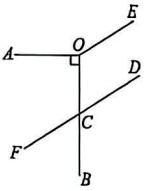

已知：如图，$OA \perp OB$，点 C 在射线 OB 上，经过 C 点的直线 $DF \parallel OE$，$\angle BCF=60^\circ$。求 $\angle AOE$ 的度数。

> [!question]- 点击查看答案与解析
> **【答案】** $\angle AOE=30^{\circ}$
> **【考点】** 垂直、平行线的性质、角的计算 → [[【初中数学知识点体系-人教版】#7-1 相交线]]、[[【初中数学知识点体系-人教版】#7-2 平行线]]
> **【解析】** 因为 $OA\perp OB$，所以 $\angle AOB=90^{\circ}$。因为 $DF \parallel OE$，所以 $\angle BCF=\angle BOE$（同位角相等）。又因为 $\angle BCF=60^{\circ}$，所以 $\angle BOE=60^{\circ}$。因为 $\angle AOB=90^{\circ}$，$\angle BOE=60^{\circ}$，所以 $\angle AOE=\angle AOB-\angle BOE=90^{\circ}-60^{\circ}=30^{\circ}$。
> **【易错点】** 不能正确利用平行线的性质找到 $\angle BCF$ 与 $\angle BOE$ 的关系，或角度计算时加减出错。
