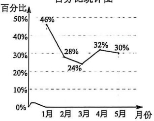
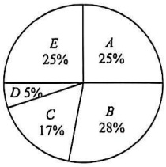

某电子品牌商下设台式电脑部、平板电脑部、手机部等. 2018年的前五个月该品牌全部商品销售额共计 600 万元. 下表表示该品牌商 2018 年前五个月的月销售额（统计信息不全）. 图1表示该品牌手机部各月销售额占该品牌所有商品当月销售额的百分比情况统计图.

品牌月销售额统计表（单位：万元） 

| 月份 | 1月 | 2月 | 3月 | 4月 | 5月 |
|---|---|---|---|---|---|
| 品牌月销售额 | 180 | 90 | 115 | 95 |  |

手机部各月销售额占品牌当月销售额的百分比统计图

图1 

5月份手机部各机型销售额占5月份手机部销售额的百分比统计图

图2 

（1）该品牌5月份的销售额是 ___ 万元；

（2）手机部5月份的销售额是 ___ 万元；小明同学观察图1后认为，手机部5月份的销售额比手机部4月份的销售额减少了，你同意他的看法吗？请说明理由：

（3）该品牌手机部有 A、B、C、D、E 五个机型，图2表示在5月份手机部各机型销售额占5月份手机部销售额的百分比情况统计图. 则5月份 ___ 机型的销售额最高，销售额最高的机型占5月份该品牌销售额的百分比是 ___ .

> [!question]- 点击查看答案与解析
> **【答案】** （1）120；（2）24 万元，不同意，理由见解析；（3）D，$8\%$
> **【考点】** 统计图表分析 → [[【初中数学知识点体系-人教版】#12-1 统计调查]]、[[【初中数学知识点体系-人教版】#12-2 用统计图描述数据]]
> **【解析】** （1）前五个月总销售额为 600 万元，1 至 4 月销售额之和 $=180+90+115+95=480$（万元），所以 5 月份销售额 $=600-480=120$（万元）。（2）由图 1 可知，5 月份手机部销售额占品牌当月销售额的 $20\%$，所以手机部 5 月份销售额 $=120\times 20\%=24$（万元）。4 月份手机部销售额 $=95\times 24\%=22.8$（万元）。因为 $24>22.8$，所以手机部 5 月份的销售额比 4 月份增加了，不同意小明的看法。小明错误地将百分比的下降等同于实际销售额的下降，实际上 5 月份品牌总销售额（120 万元）远高于 4 月份（95 万元），虽然百分比从 $24\%$ 降到 $20\%$，但实际销售额反而增加了。（3）由图 2 可知，D 机型占比最高，为 $40\%$。D 机型销售额 $=24\times 40\%=9.6$（万元），占 5 月份品牌销售额的百分比 $=\dfrac{9.6}{120}\times 100\%=8\%$。
> **【易错点】** 混淆百分比与实际数值的关系，不能正确计算 5 月份总销售额，或在计算占比时遗漏步骤。
