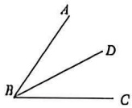

如图，已知 BD 平分 $\angle ABC$. 请补全图形后，依条件完成解答.

（1）在直线 BC 下方画 ∠CBE，使 ∠CBE 与 ∠ABC 互补；

（2）在射线 BE 上任取一点 F，过点 F 画直线 FG // BD 交 BC 于点 G；

（3）判断 $\angle BFG$ 与 $\angle BGF$ 的数量关系，并说明理由.

> [!question]- 点击查看答案与解析
> **【答案】** （1）（2）作图略；（3）$\angle BFG=\angle BGF$
> **【考点】** 角平分线、平行线的性质、互补角 → [[【初中数学知识点体系-人教版】#7-2 平行线]]
> **【解析】** （1）在直线 $BC$ 下方画 $\angle CBE$，使 $\angle CBE+\angle ABC=180^{\circ}$（互补）。（2）在射线 $BE$ 上任取一点 $F$，过 $F$ 画 $FG \parallel BD$ 交 $BC$ 于 $G$。（3）$\angle BFG=\angle BGF$。理由：因为 $BD$ 平分 $\angle ABC$，设 $\angle ABD=\angle DBC=\alpha$，则 $\angle ABC=2\alpha$。因为 $\angle CBE$ 与 $\angle ABC$ 互补，所以 $\angle CBE=180^{\circ}-2\alpha$。因为 $FG \parallel BD$，所以 $\angle BFG=\angle ABD=\alpha$（内错角相等），$\angle BGF=\angle DBC=\alpha$（同位角相等）。所以 $\angle BFG=\angle BGF=\alpha$。
> **【易错点】** 作图时不能准确作出互补角，或在推理时不能正确利用平行线的性质找到角的关系。
