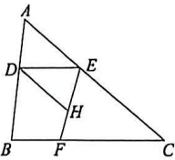
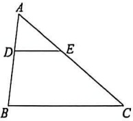
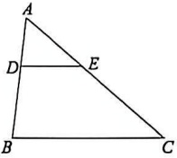

在三角形 ABC 中，点 D 在线段 AB 上，DE // BC 交 AC 于点 E，点 F 在直线 BC 上，作直线 EF，过点 D 作直线 DH // AC 交直线 EF 于点 H.

（1）在如图1所示的情况下，求证：$\angle HDE = \angle C$；

（2）若三角形 ABC 不变，D，E 两点的位置也不变，点 F 在直线 BC 上运动.

$①$ 当点 H 在三角形 ABC 内部时，直接写出 $\angle DHF$ 与 $\angle FEC$ 的数量关系；

$②$ 当点 H 在三角形 ABC 外部时，$①$ 中结论是否依然成立？请在图 2 中画图探究，并说明理由.

图1 

图2-1 

图2-2 

> [!question]- 点击查看答案与解析
> **【答案】** （1）证明见解析；（2）$①$ $\angle DHF+\angle FEC=180^{\circ}$；$②$ 画图探究见解析
> **【考点】** 平行线的性质、三角形内角和 → [[【初中数学知识点体系-人教版】#7-2 平行线]]、[[【初中数学知识点体系-人教版】#13-3 三角形的内角与外角]]
> **【解析】** （1）因为 $DE \parallel BC$，所以 $\angle AED=\angle C$（同位角相等）。因为 $DH \parallel AC$，所以 $\angle HDE=\angle AED$（内错角相等）。所以 $\angle HDE=\angle C$。（2）$①$ 当点 $H$ 在三角形 $ABC$ 内部时：因为 $DH \parallel AC$，所以 $\angle DHF=\angle FEC$ 的补角关系可通过平行线性质推导。由 $DE \parallel BC$ 和 $DH \parallel AC$，利用平行线性质可得 $\angle DHF+\angle FEC=180^{\circ}$。$②$ 当点 $H$ 在三角形 $ABC$ 外部时，$\angle DHF=\angle FEC$。理由：当点 $F$ 在 $BC$ 上运动使 $H$ 在三角形外部时，$DH \parallel AC$ 和 $DE \parallel BC$ 两组平行线仍然成立。由 $DE \parallel BC$，$\angle HDE=\angle C$（已证）。由 $DH \parallel AC$，$\angle DHE=\angle HEC$（内错角）。因为 $\angle DHF$ 与 $\angle DHE$ 互补，$\angle FEC$ 与 $\angle HEC$ 互补（或相等，取决于 $F$ 的位置），通过平行线的性质可推导出 $\angle DHF=\angle FEC$。
> **【易错点】** 不能准确利用两组平行线的性质进行角度推导，或在点 $F$ 位置变化时不能正确分析角的关系。
