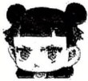
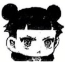

《哪吒之魔童闹海》以震撼特效、精彩故事、鲜活形象和浓厚文化，展现了中国动画电影的强劲实力，通过平移图“哪吒头像”可以得到的图形是 ( )

A.

B.

C.

D.

> [!question]- 点击查看答案与解析
> 【答案】B
> 
> 【考点】平移的性质 → [[【初中数学知识点体系-人教版】#6-1 几何图形]]
> 
> 【解析】
> 平移是指图形上所有点沿同一方向移动相同距离，平移后图形的大小、形状、方向都不变。
> - 选项A：方向改变了（旋转了），不是平移；
> - 选项B：图形的形状、大小、方向都不变，只是位置改变了，是平移，正确；
> - 选项C：图形镜像翻转了，不是平移；
> - 选项D：方向改变了，不是平移。
> 
> 【易错点】平移不改变图形的形状、大小和方向。
