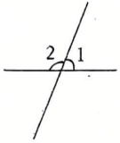
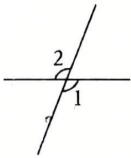
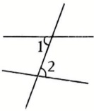
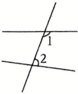

下列四个图形中，$\angle 1 = \angle 2$ 一定成立的是 ( )

A.

B.

C.

D.

> [!question]- 点击查看答案与解析
> 【答案】C
> 
> 【考点】对顶角的性质 → [[【初中数学知识点体系-人教版】#7-1 相交线]]
> 
> 【解析】
> - 选项A：$\angle 1$ 与 $\angle 2$ 是邻补角，和为 $180^{\circ}$，不一定相等；
> - 选项B：$\angle 1$ 与 $\angle 2$ 是三角形的外角与内角，不一定相等；
> - 选项C：$\angle 1$ 与 $\angle 2$ 是对顶角，对顶角相等，正确；
> - 选项D：$\angle 1$ 与 $\angle 2$ 没有必然的相等关系。
> 
> 【易错点】对顶角一定相等。
