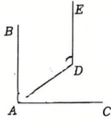

如图，$AB \perp AC$，$\angle CAD = 37^{\circ}$，$DE // AB$，则 $\angle ADE$ 的度数为 ( )

A. $120^{\circ}$

B. $127^{\circ}$

C. $133^{\circ}$

D. $143^{\circ}$

> [!question]- 点击查看答案与解析
> 【答案】B
> 
> 【考点】平行线的性质、垂直的性质 → [[【初中数学知识点体系-人教版】#7-2 平行线]]
> 
> 【解析】
> 因为 $AB\perp AC$，所以 $\angle BAC=90^{\circ}$。
> $\angle BAD=\angle BAC+\angle CAD=90^{\circ}+37^{\circ}=127^{\circ}$。
> 因为 $DE\parallel AB$，所以 $\angle ADE=\angle BAD=127^{\circ}$（两直线平行，内错角相等）。
> - 选项A、C、D：计算错误；
> - 选项B：$127^{\circ}$，正确。
> 
> 【易错点】利用平行线性质转化角，注意角的位置关系。
