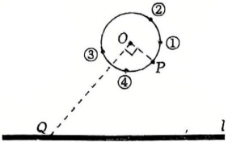

如图，电子宠物 $P$ 在圆上运动，点 $O$ 处设置有一个信号转换器，将宠物 $P$ 的位置信号沿着垂直于线段 $OP$ 的方向 $OQ$ 传送，被信号接收板 $l$ 接收．若传送距离越近，接收到的信号越强，则当 $P$ 点运动到图中 ___ 号点的位置时，接收到的信号最强． ( )

A. $①$

B. $②$

C. $③$

D. $④$

> [!question]- 点击查看答案与解析
> 【答案】C
> 
> 【考点】垂线段最短 → [[【初中数学知识点体系-人教版】#7-1 相交线]]
> 
> 【解析】
> 信号沿着垂直于 $OP$ 的方向 $OQ$ 传送，接收板 $l$ 接收。
> 传送距离越近，信号越强。
> 要使传送距离最近，需要 $OQ$ 垂直于 $l$，此时 $OQ$ 是点 $O$ 到直线 $l$ 的垂线段。
> 根据垂线段最短，当 $OP$ 与 $OQ$ 的交点使得 $OQ$ 最短时信号最强。
> 从图中看，$③$ 号点使 $OQ$ 垂直于 $l$，传送距离最短。
> 
> 【易错点】垂线段最短的应用。
