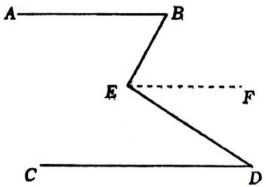

完成下面的证明：

已知：如图，$\angle BED = \angle B + \angle D$。

求证：$AB // CD$.

证明：过点 $E$ 作 $EF // AB$

$\therefore \angle B = \_\_\_\_\_\_$（依据：\_\_\_\_\_\_）.

$\because \angle BED = \angle BEF + \angle DEF, \angle BED = \angle B + \angle D.$

$\therefore \angle D = \angle DEF$.

$\therefore$ ___ // ___ （依据：\_\_\_\_\_\_）.

$\therefore AB // CD$（依据：\_\_\_\_\_\_）.

> [!question]- 点击查看答案与解析
> 【答案】见解析
> 
> 【考点】平行线的判定与性质 → [[【初中数学知识点体系-人教版】#7-2 平行线]]
> 
> 【解析】
> 证明：过点 $E$ 作 $EF\parallel AB$。
> $\therefore \angle B=\angle BEF$（依据：两直线平行，内错角相等）。
> $\because \angle BED=\angle BEF+\angle DEF$，$\angle BED=\angle B+\angle D$。
> $\therefore \angle D=\angle DEF$。
> $\therefore EF\parallel CD$（依据：内错角相等，两直线平行）。
> $\therefore AB\parallel CD$（依据：平行于同一直线的两直线平行）。
> 
> 【易错点】作辅助平行线是解决此类问题的关键。
