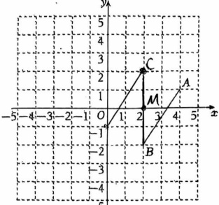

如图，在平面直角坐标系 $xOy$ 中，$A, B$ 两点的坐标分别为 $A(4, 1)$，$B(2, -2)$．过点 $B$ 作 $x$ 轴的垂线，垂足为 $M$，在 $BM$ 的延长线上截取 $MC = BM$，将线段 $AB$ 平移得到线段 $CD$ （其中点 $A$ 的对应点为点 $C$，点 $B$ 的对应点为点 $D$）．

(1) 补全图形，直接写出点 $C$ 和点 $D$ 的坐标；

(2) 直接写出三角形 $ABD$ 的面积.

> [!question]- 点击查看答案与解析
> 【答案】(1) $C(2, 2)$，$D(0, -1)$；(2) 4
> 
> 【考点】平面直角坐标系、平移、三角形面积 → [[【初中数学知识点体系-人教版】#9-2 坐标方法的简单应用]]
> 
> 【解析】
> (1) $B(2, -2)$，$BM\perp x$ 轴，$M(2, 0)$。
> $MC=BM=2$，$C$ 在 $BM$ 的延长线上（$M$ 上方），所以 $C(2, 2)$。
> 线段 $AB$ 平移得到线段 $CD$，$A$ 对应 $C$，$B$ 对应 $D$。
> 平移向量为 $C-A=(2-4, 2-1)=(-2, 1)$。
> $D=B+(-2, 1)=(2-2, -2+1)=(0, -1)$。
> 
> (2) 三角形 $ABD$ 的面积：
> $A(4, 1)$，$B(2, -2)$，$D(0, -1)$。
> 利用坐标公式：
> 面积 $=\frac{1}{2}|x_1(y_2-y_3)+x_2(y_3-y_1)+x_3(y_1-y_2)|$
> $=\frac{1}{2}|4(-2-(-1))+2(-1-1)+0(1-(-2))|$
> $=\frac{1}{2}|4(-1)+2(-2)+0|=\frac{1}{2}\times 8=4$。
> 
> 【易错点】平移的性质：对应点的平移向量相同；三角形面积公式。
