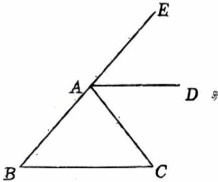

如图，已知 ___ ，且 $AD // BC$，求证：___ .

给出下列两个条件：

$①$ $\angle B = \angle C$；$②$ $\angle EAD = \angle CAD$。

请将 $①②$ 中的一个作为题设，填在 “已知” 后的空格中，另一个作为结论填在 “求证” 后的空格中，构造出一个真命题，并给出相应的证明.

证明：

> [!question]- 点击查看答案与解析
> 【答案】见解析
> 
> 【考点】平行线的性质、角平分线 → [[【初中数学知识点体系-人教版】#7-2 平行线]]
> 
> 【解析】
> 选择：已知 $\angle B=\angle C$，且 $AD\parallel BC$，求证 $\angle EAD=\angle CAD$。
> 
> 证明：
> $\because AD\parallel BC$（已知），
> $\therefore \angle EAD=\angle B$（两直线平行，同位角相等），
> $\angle CAD=\angle C$（两直线平行，内错角相等）。
> $\because \angle B=\angle C$（已知），
> $\therefore \angle EAD=\angle CAD$（等量代换）。
> 
> （也可选择已知 $\angle EAD=\angle CAD$，求证 $\angle B=\angle C$，证明类似。）
> 
> 【易错点】平行线的判定与性质的区别。
