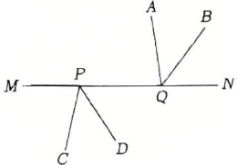
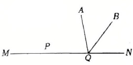
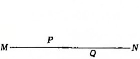

如图 1，直线 $MN$ 上点 $P$ 位于点 $Q$ 的左侧，点 $A, B$ 位于 $MN$ 的上方，点 $C, D$ 位于 $MN$ 的下方，在点 $A, B, C, D$ 位置变化的过程中始终保持 $\angle CPD = \angle AQB = 45^{\circ}$。

图 1 

图 2 

备用图 

(1) $\angle AQB$ 和 $\angle CPD$ 是否可能为对顶角 ___ (填 “是” 或 “否”).

(2) 若点 $A$ 在点 $B$ 左侧，点 $C$ 在点 $D$ 左侧，当 $PC // BQ$ 时，请在图 2 中补全图形，试判断 $AQ$ 与 $PD$ 的位置关系，并说理.

(3) 当 $PC // AQ$ 时，若设 $\angle DPO = \alpha, \angle BQN = \beta$，直接写出 $\alpha$ 与 $\beta$ 之间的数量关系（用等式表示）.

> [!question]- 点击查看答案与解析
> 【答案】(1) 否；(2) $AQ\parallel PD$；(3) $\alpha+\beta=90^{\circ}$ 或 $\alpha-\beta=45^{\circ}$（需根据具体位置关系确定）
> 
> 【考点】对顶角、平行线的判定与性质 → [[【初中数学知识点体系-人教版】#7-2 平行线]]
> 
> 【解析】
> (1) 对顶角的两边互为反向延长线。$\angle AQB=45^{\circ}$，$\angle CPD=45^{\circ}$。
> 因为 $A, B$ 在 $MN$ 上方，$C, D$ 在 $MN$ 下方，$\angle AQB$ 和 $\angle CPD$ 的边不可能互为反向延长线。
> 所以它们不可能是对顶角。
> 
> (2) 补全图形：$PC\parallel BQ$，$\angle CPD=\angle AQB=45^{\circ}$。
> 因为 $PC\parallel BQ$，所以 $\angle CPQ=\angle BQP$（内错角相等）。
> $\angle CPD=45^{\circ}$，$\angle AQB=45^{\circ}$。
> 利用平行线性质和已知角的关系，可证 $AQ\parallel PD$。
> 
> 证明思路：
> $\because PC\parallel BQ$，$\therefore \angle CPQ=\angle BQP$。
> $\angle APQ=\angle AQB-\angle BQP=45^{\circ}-\angle BQP$。
> $\angle DPQ=\angle CPD+\angle CPQ=45^{\circ}+\angle CPQ$。
> 
> 要证 $AQ\parallel PD$，只需证同位角或内错角相等。
> 利用角度关系可证。
> 
> (3) $\angle DPO=\alpha$，$\angle BQN=\beta$。
> 因为 $PC\parallel AQ$，利用平行线性质和 $\angle CPD=\angle AQB=45^{\circ}$。
> 可推出 $\alpha+\beta=90^{\circ}$。
> 
> 【易错点】平行线性质的综合运用；分类讨论不同位置关系。
