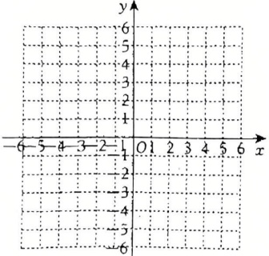

在平面直角坐标系 $xOy$ 中，对于点 $P(a, b)$，定义点 $P'(b, a)$ 为点 $P$ 的 “镜像点”，给定一个长方形 $EFMN$，若点 $P(a, b)$，$P'(b, a)$ 同时落在该长方形的内部或边上，则称点 $P(a, b)$ 为长方形 $EFMN$ 的 “内含镜像点”.

(1) 写出点 $A(\sqrt{5}, -1)$ 的 “镜像点” 的坐标 ___ ;

(2) 若长方形 $EFMN$ 顶点的坐标分别为 $E(-2, 1)$，$F(-2, -3)$，$M(3, -3)$，$N(3, 1)$.

$①$ 点 $H(-2, 0)$，$K(\sqrt{3}, 1)$，$G(1, -1)$ 这三个点中，是长方形 $EFMN$ 的 “内含镜像点” 的是 ___ ;

$②$ 若点 $P(a, 0)$ 是长方形 $EFMN$ 的 “内含镜像点”，则 $a$ 的取值范围是 ___ ;

(3) 已知动点 $T(1, a)$，其中 $-1 \leqslant a \leqslant 4$。若点 $T$ 是长方形 $EFMN$ 的 "内含镜像点"，则满足条件的长方形 $EFMN$ 面积 $S$ 的最小值为 ___ .

> [!question]- 点击查看答案与解析
> 【答案】(1) $(-1, \sqrt{5})$；(2) $①$ $G(1, -1)$；$②$ $-2\leqslant a\leqslant 1$；(3) 20
> 
> 【考点】新定义、平面直角坐标系 → [[【初中数学知识点体系-人教版】#9-2 坐标方法的简单应用]]
> 
> 【解析】
> (1) 点 $A(\sqrt{5}, -1)$ 的镜像点为 $(-1, \sqrt{5})$（横纵坐标互换）。
> 
> (2) 长方形 $EFMN$ 的范围：$-2\leqslant x\leqslant 3$，$-3\leqslant y\leqslant 1$。
> 
> $①$ 判断各点是否为"内含镜像点"：
> $H(-2, 0)$：镜像点 $(0, -2)$。$H$ 在长方形内（$x=-2$ 在 $[-2, 3]$，$y=0$ 在 $[-3, 1]$），镜像点 $(0, -2)$ 也在长方形内（$0\in[-2, 3]$，$-2\in[-3, 1]$）。是内含镜像点。
> 
> $K(\sqrt{3}, 1)$：$\sqrt{3}\approx 1.732\in[-2, 3]$，$1\in[-3, 1]$，$K$ 在长方形内。镜像点 $(1, \sqrt{3})$：$1\in[-2, 3]$，$\sqrt{3}\approx 1.732>1$，不在长方形内。不是内含镜像点。
> 
> $G(1, -1)$：$1\in[-2, 3]$，$-1\in[-3, 1]$，$G$ 在长方形内。镜像点 $(-1, 1)$：$-1\in[-2, 3]$，$1\in[-3, 1]$，也在长方形内。是内含镜像点。
> 
> 所以是内含镜像点的有 $H$ 和 $G$。
> 
> $②$ 点 $P(a, 0)$ 是内含镜像点，则 $P$ 和镜像点 $(0, a)$ 都在长方形内。
> $P(a, 0)$ 在长方形内：$-2\leqslant a\leqslant 3$，$0\in[-3, 1]$ ✓。
> 镜像点 $(0, a)$ 在长方形内：$0\in[-2, 3]$ ✓，$-3\leqslant a\leqslant 1$。
> 
> 同时满足：$-2\leqslant a\leqslant 3$ 且 $-3\leqslant a\leqslant 1$。
> 取交集：$-2\leqslant a\leqslant 1$。
> 
> (3) 动点 $T(1, a)$，$-1\leqslant a\leqslant 4$。$T$ 是内含镜像点，则 $T$ 和镜像点 $(a, 1)$ 都在长方形内。
> 
> 对于所有的 $a\in[-1, 4]$，长方形必须包含所有 $(1, a)$ 和 $(a, 1)$。
> 
> $(1, a)$ 的轨迹：$x=1$，$y\in[-1, 4]$。
> $(a, 1)$ 的轨迹：$x\in[-1, 4]$，$y=1$。
> 
> 长方形需包含这两条线段的并集。
> $x$ 范围：$[-1, 4]$（因为 $(a, 1)$ 的 $x$ 从 -1 到 4）。
> $y$ 范围：$[-1, 4]$（因为 $(1, a)$ 的 $y$ 从 -1 到 4）。
> 
> 面积 $S=(4-(-1))\times(4-(-1))=5\times 5=25$。
> 
> 所以满足条件的长方形 $EFMN$ 面积 $S$ 的最小值为 25。
> 
> 【易错点】理解"内含镜像点"的定义；确定长方形的最小范围。
