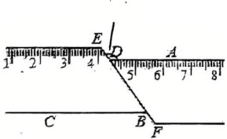

如图，一把矩形直尺沿直线断开并错位，点 $E, D, B, F$ 在同一条直线上。若 $\angle ADE = 125^{\circ}$，则 $\angle DBC$ 的度数为 ( )

(第 5 题) 

A. $55^{\circ}$

B. $65^{\circ}$

C. $75^{\circ}$

D. $125^{\circ}$

> [!question]- 点击查看答案与解析
> 【答案】A
>
> 【考点】平行线性质、邻补角 → [[【初中数学知识点体系-人教版】#7-2 平行线]]
>
> 【解析】
> 矩形直尺的两边平行，即 $AD\parallel BC$。
> $\angle ADE=125^{\circ}$，$\angle ADB=180^{\circ}-125^{\circ}=55^{\circ}$（邻补角）。
> 因为 $AD\parallel BC$，所以 $\angle DBC=\angle ADB=55^{\circ}$（两直线平行，内错角相等）。
> - 选项A：$55^{\circ}$，正确；
> - 选项B、C、D：计算错误。
>
> 【易错点】利用邻补角和平行线性质逐步求解。
