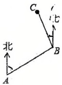

如图，周董从 $A$ 处出发沿北偏东 $60^{\circ}$ 方向行走至 $B$ 处，又沿北偏西 $20^{\circ}$ 方向行走至 $C$ 处，则 $\angle ABC$ 的度数是 ( )

(第 6 题) 

A. $80^{\circ}$

B. $90^{\circ}$

C. $100^{\circ}$

D. $95^{\circ}$

> [!question]- 点击查看答案与解析
> 【答案】C
>
> 【考点】方位角、平行线 → [[【初中数学知识点体系-人教版】#7-2 平行线]]
>
> 【解析】
> 在 $A$ 点和 $B$ 点各作一条南北方向的平行线。
> $A$ 点的北向与 $AB$ 夹角为 $60^{\circ}$（北偏东 $60^{\circ}$）。
> $B$ 点的北向与 $BC$ 夹角为 $20^{\circ}$（北偏西 $20^{\circ}$）。
> $\angle ABC=180^{\circ}-60^{\circ}-20^{\circ}=100^{\circ}$。
> - 选项A、B、D：计算错误；
> - 选项C：$100^{\circ}$，正确。
>
> 【易错点】利用平行线性质，将方位角转化为角度关系。
