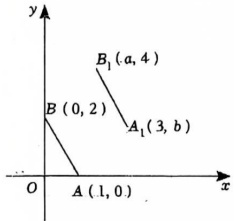

如图，$A(1, 0)$，$B(0, 2)$。若将线段 $AB$ 平移至 $A_{1}B_{1}$，则 $5a - b$ 的值为 ( )

(第 7 题) 

A. 6

B. 8

C. -8

D. 10

> [!question]- 点击查看答案与解析
> 【答案】B
>
> 【考点】平移 → [[【初中数学知识点体系-人教版】#9-2 坐标方法的简单应用]]
>
> 【解析】
> $A(1, 0)\to A_1(3, a)$，$B(0, 2)\to B_1(b, 4)$。
> 平移向量相同：$A_1-A=(3-1, a-0)=(2, a)$。
> $B_1-B=(b-0, 4-2)=(b, 2)$。
>
> 平移向量相同，所以 $b=2$，$a=2$。
> $5a-b=5\times 2-2=10-2=8$。
>
> 【易错点】平移的性质：对应点的平移向量相同。
