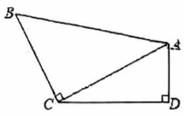

如图，在三角形 $ABC$ 中，$\angle ACB = 90^{\circ}$，过点 $A$ 作 $AD \perp CD$ 于点 $D$。若 $AB = \sqrt{5}$，$CD = \sqrt{3}$，则 $AC$ 的长可能是 ( )

(第 8 题) 

A. 3

B. 2.5

C. 2

D. 1.5

> [!question]- 点击查看答案与解析
> 【答案】C
>
> 【考点】直角三角形、垂线段 → [[【初中数学知识点体系-人教版】#7-1 相交线]]
>
> 【解析】
> $\angle ACB=90^{\circ}$，$AB=\sqrt{5}$。$AD\perp CD$，$CD=\sqrt{3}$。
> 在 $\triangle ABC$ 中，由勾股定理：$AC^2+BC^2=AB^2=5$。
> 在 $\triangle ACD$ 中，$AC>CD=\sqrt{3}$（斜边大于直角边）。
> 同时 $AC<AB=\sqrt{5}\approx 2.236$（直角三角形的直角边小于斜边）。
>
> 所以 $\sqrt{3}<AC<\sqrt{5}$，即 $1.732<AC<2.236$。
> - 选项A：3，不在范围内；
> - 选项B：2.5，不在范围内；
> - 选项C：2，在范围内，正确；
> - 选项D：1.5，不在范围内。
>
> 【易错点】利用直角三角形的边的关系确定范围。
