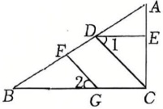

如图，如果 $\angle 1 = \angle 2$，$DE // BC$，有下列结论：$① FG // DC$；$② \angle AED = \angle ACB$；$③ CD$ 平分 $\angle ACB$；$④ \angle BFG + \angle ADC = 180^{\circ}$。正确的个数为 ( )

第 9 题 

A. 4 个

B. 3 个

C. 2 个

D. 1 个

> [!question]- 点击查看答案与解析
> 【答案】B
>
> 【考点】平行线判定与性质 → [[【初中数学知识点体系-人教版】#7-2 平行线]]
>
> 【解析】
> 已知 $\angle 1=\angle 2$，$DE\parallel BC$。
> $①$ $DE\parallel BC$，所以 $\angle 1=\angle DCB$（两直线平行，内错角相等）。
> 又 $\angle 1=\angle 2$，所以 $\angle 2=\angle DCB$。
> $\angle 2$ 与 $\angle DCB$ 是同位角，所以 $FG\parallel DC$，正确。
> $②$ $DE\parallel BC$，所以 $\angle AED=\angle ACB$（两直线平行，同位角相等），正确。
> $③$ 没有条件说明 $CD$ 平分 $\angle ACB$，错误。
> $④$ $FG\parallel DC$，所以 $\angle BFG=\angle BDC$（两直线平行，同位角相等）。
> $\angle BDC+\angle ADC=180^{\circ}$（邻补角）。
> 所以 $\angle BFG+\angle ADC=180^{\circ}$，正确。
>
> 正确的有 $①②④$，共 3 个。
> - 选项A、C、D：数量不对；
> - 选项B：3 个，正确。
>
> 【易错点】综合运用平行线的判定和性质。
