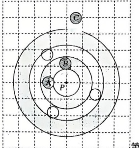

冰壶，被喻为冰上的“国际象棋”，它考验参与者的体能与脑力，展现动静之美，取舍之智慧，属于冬奥会比赛项目。冰壶运动的计分方法是：图中最大圆及其内部为有效圈，点 $P$ 为有效圈中心；一队每颗位于有效圈中且位置较另一队所有冰壶都更接近点 $P$ 的冰壶皆可获计一分。在图中，分别以水平向右、竖直向上的方向为 $x$ 轴、$y$ 轴的正方向建立平面直角坐标系，下列选项对各冰壶位置描述正确的是 ( )

第 10 题 

A. 若得分壶 $A$ 的坐标为 $(0, 1)$，得分壶 $B$ 的坐标为 $(1, 2)$，则冰壶 $C$ 的坐标约为 $(0.5, 4)$

B. 若得分壶 $A$ 的坐标为 $(0, -2)$，得分壶 $B$ 的坐标为 $(2, 0)$，则冰壶 $C$ 的坐标约为 $(3, 3)$

C. 若得分壶 $A$ 的坐标为 $(-2, 0)$，得分壶 $B$ 的坐标为 $(0, 2)$，则冰壶 $C$ 的坐标约为 $(1, 8)$

D. 若得分壶 $A$ 的坐标为 $(0, 0)$，得分壶 $B$ 的坐标为 $(1, 1)$，则冰壶 $C$ 的坐标约为 $(4, 1.5)$

> [!question]- 点击查看答案与解析
> 【答案】A
>
> 【考点】坐标系 → [[【初中数学知识点体系-人教版】#9-1 用坐标描述平面内点的位置]]
>
> 【解析】
> 根据题意，以水平向右为 $x$ 轴正方向，竖直向上为 $y$ 轴正方向。
> - 选项A：若 $A(0, 1)$，$B(1, 2)$，则 $P$ 点（圆心）大约在 $(0, 0)$ 附近。$C$ 在 $A$ 和 $B$ 之间偏上，坐标约为 $(0.5, 4)$，合理；
> - 选项B：若 $A(0, -2)$，$B(2, 0)$，则 $C$ 的 $y$ 坐标不应这么大；
> - 选项C：若 $A(-2, 0)$，$B(0, 2)$，则 $C$ 的 $y$ 坐标 $8$ 过大；
> - 选项D：若 $A(0, 0)$，$B(1, 1)$，则 $C$ 的 $x$ 坐标 $4$ 过大。
>
> 综合考虑图形的相对位置，选项A最合理。
>
> 【易错点】根据已知点确定坐标系，判断其他点的位置。
