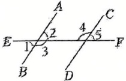

如图，写出一个可以证明 $AB // CD$ 的条件： ___ .

> [!question]- 点击查看答案与解析
> 【答案】$\angle A=\angle DCE$（或 $\angle B=\angle BCD$，或 $\angle B+\angle BCD=180^{\circ}$ 等，答案不唯一）
>
> 【考点】平行线判定 → [[【初中数学知识点体系-人教版】#7-2 平行线]]
>
> 【解析】
> 要使 $AB\parallel CD$，可以添加的条件：
> - 同位角相等：如 $\angle A=\angle DCE$；
> - 内错角相等：如 $\angle B=\angle BCD$；
> - 同旁内角互补：如 $\angle B+\angle BCD=180^{\circ}$。
>
> 【易错点】找准哪两条直线被哪条直线所截形成的角。
