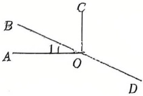

如图，点 $O$ 在直线 $BD$ 上，已知 $\angle COD = 105^{\circ}$，$OC \perp OA$，则 $\angle 1$ 的度数为 ___ .

> [!question]- 点击查看答案与解析
> 【答案】$15^{\circ}$
>
> 【考点】垂直性质 → [[【初中数学知识点体系-人教版】#7-1 相交线]]
>
> 【解析】
> $OC\perp OA$，所以 $\angle COA=90^{\circ}$。
> $\angle COD=105^{\circ}$，$\angle AOD=\angle COD-\angle COA=105^{\circ}-90^{\circ}=15^{\circ}$。
> 因为点 $O$ 在直线 $BD$ 上，$\angle 1=\angle AOD=15^{\circ}$。
>
> 【易错点】利用垂直定义和角的和差关系求解。
