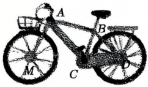
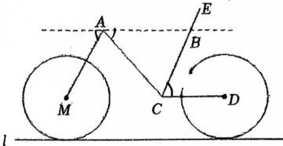

为了方便市民绿色出行和锻炼身体，政府倡导大家使用共享单车。图 1 是一辆共享单车放在水平地面上的实物图，图 2 是其示意图，其中 $AB, CD$ 都与地面 $l$ 平行，$\angle BCD = 55^{\circ}$， $\angle BAC = 52^{\circ}$。当 $\angle MAC$ 等于 ___ 度时，$AM$ 与 $BC$ 平行。

图 1 

图 2 

> [!question]- 点击查看答案与解析
> 【答案】73
>
> 【考点】平行线性质 → [[【初中数学知识点体系-人教版】#7-2 平行线]]
>
> 【解析】
> $AB\parallel CD$（都与地面 $l$ 平行），所以 $\angle ABC=\angle BCD=55^{\circ}$（两直线平行，内错角相等）。
> 在 $\triangle ABC$ 中，$\angle ACB=180^{\circ}-\angle BAC-\angle ABC=180^{\circ}-52^{\circ}-55^{\circ}=73^{\circ}$。
> 要使 $AM\parallel BC$，则 $\angle MAC=\angle ACB=73^{\circ}$（两直线平行，内错角相等）。
>
> 【易错点】正确识别角的位置关系，利用平行线性质建立角的关系。
