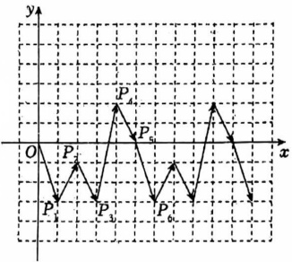

如图，动点 $P$ 在平面直角坐标系中按图中箭头所示方向运动，第一次从原点 $O$ 运动到点 $P_{1}(1, -3)$，第二次运动到点 $P_{2}(2, -1)$，第三次运动到 $P_{3}(3, -3)$...。按这样的运动规律，第 2024 次运动后，动点 $P_{2024}$ 的坐标是 ___ .

> [!question]- 点击查看答案与解析
> 【答案】$(2024, -1)$
>
> 【考点】坐标规律 → [[【初中数学知识点体系-人教版】#9-2 坐标方法的简单应用]]
>
> 【解析】
> 观察运动规律：
> - 第 1 次：$P_1(1, -3)$
> - 第 2 次：$P_2(2, -1)$
> - 第 3 次：$P_3(3, -3)$
> - 第 4 次：$P_4(4, -1)$
> - 第 5 次：$P_5(5, -3)$
>
> 横坐标：每次增加 1，第 $n$ 次后横坐标为 $n$。
> 纵坐标：$-3, -1, -3, -1, -3, -1, \cdots$，周期为 2。
> 当 $n$ 为奇数时，纵坐标为 $-3$；当 $n$ 为偶数时，纵坐标为 $-1$。
>
> 第 2024 次，$2024$ 为偶数，纵坐标为 $-1$。
> 所以 $P_{2024}(2024, -1)$。
>
> 【易错点】观察横纵坐标的变化规律，注意周期性。
