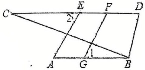

已知：如图，$AE \perp BC$，$FG \perp BC$，$\angle 1 = \angle 2$，求证：$AB // CD$.

> [!question]- 点击查看答案与解析
> 【答案】见解析
>
> 【考点】平行线判定 → [[【初中数学知识点体系-人教版】#7-2 平行线]]
>
> 【解析】
> 证明：
> $\because AE\perp BC$，$FG\perp BC$（已知），
> $\therefore AE\parallel FG$（垂直于同一直线的两直线平行），
> $\therefore \angle 1=\angle EAB$（两直线平行，同位角相等）。
> 又 $\because \angle 1=\angle 2$（已知），
> $\therefore \angle 2=\angle EAB$（等量代换），
> $\therefore AB\parallel CD$（内错角相等，两直线平行）。
>
> 【易错点】垂直于同一直线的两直线平行。
