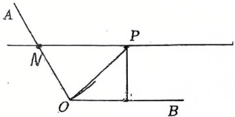

如图，点 $P$ 为 $\angle AOB$ 内一点，根据下列语句画图并回答问题：

(1) 画图：$①$ 过点 $P$ 画 $OB$ 边的垂线，垂足为点 $M$; $②$ 过点 $P$ 画 $OB$ 边的平行线，交 $OA$ 于点 $N$;

(2) 连接 $OP$，则线段 $OP$ 与 $PM$ 的大小关系是 ___ ，依据是 ___ .

> [!question]- 点击查看答案与解析
> 【答案】(1) 见解析；(2) $OP>PM$，垂线段最短
>
> 【考点】尺规作图、垂线段 → [[【初中数学知识点体系-人教版】#7-1 相交线]]
>
> 【解析】
> (1) 画图略（过 $P$ 作 $OB$ 的垂线，垂足为 $M$；过 $P$ 作 $OB$ 的平行线交 $OA$ 于 $N$）。
>
> (2) $OP>PM$，依据是：垂线段最短（点 $O$ 到直线 $PM$ 的距离 $PM$ 小于斜线段 $OP$）。
>
> 【易错点】垂线段最短的应用。
