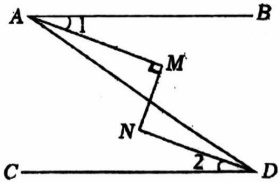

如图，$AB // CD$，$\angle 1 = \angle 2$，$AM \perp MN$，求证：$DN \perp MN$.

证明：∵ $AB // CD$,

$\therefore \angle BAD = ①$ ___ ，（$②$ ___ ）

又∵ $\angle 1 = \angle 2$,

$\therefore \angle BAD - \angle 1 = \angle ADC - \angle 2$，即 $\angle MAD = \angle NDA$,

$\therefore ③$ ___ // ___ , ($④$ ___ ) 

$\therefore \angle N = \angle M$ 

∵ $AM \perp MN$,

$\therefore \angle M = 90^{\circ}$ ($⑤$ ___ )

$\therefore \angle N = 90^{\circ}$,

$\therefore DN \perp MN$.

> [!question]- 点击查看答案与解析
> 【答案】见解析
>
> 【考点】平行线性质 → [[【初中数学知识点体系-人教版】#7-2 平行线]]
>
> 【解析】
> 证明：$\because AB\parallel CD$，
> $\therefore \angle BAD=\angle ADC$（两直线平行，内错角相等），
> 又 $\because \angle 1=\angle 2$，
> $\therefore \angle BAD-\angle 1=\angle ADC-\angle 2$，即 $\angle MAD=\angle NDA$，
> $\therefore AM\parallel DN$（内错角相等，两直线平行），
> $\therefore \angle N=\angle M$（两直线平行，内错角相等）。
> $\because AM\perp MN$，
> $\therefore \angle M=90^{\circ}$（垂直的定义），
> $\therefore \angle N=90^{\circ}$，
> $\therefore DN\perp MN$。
>
> 填空答案：$①$ $\angle ADC$；$②$ 两直线平行，内错角相等；$③$ $AM$；$④$ 内错角相等，两直线平行；$⑤$ 垂直的定义。
>
> 【易错点】平行线的判定条件与性质条件的区别。
