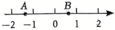

如图，一只蚂蚁从点 $A$ 沿数轴向右爬了 $2$ 个单位长度到达点 $B$，点 $A$ 表示 $-\sqrt{2}$，设点 $B$ 所表示的数为 $m$。

(1) 实数 $m$ 的值是 ___ ;

(2) 求 $| m + 1 | + | m - 1 |$ 的值;

(3) 在数轴上还有 $C, D$ 两点分别表示实数 $c$ 和 $d$，且有 $| 2c + d |$ 与 $\sqrt{d + 4}$ 互为相反数，则 $3c - 2d$ 的平方根为 ___ .

> [!question]- 点击查看答案与解析
> 【答案】(1) $2-\sqrt{2}$；(2) 2；(3) $\pm\sqrt{14}$
>
> 【考点】数轴、绝对值 → [[【初中数学知识点体系-人教版】#8-3 实数及其简单运算]]
>
> 【解析】
> (1) 蚂蚁从 $A(-\sqrt{2})$ 向右爬 2 个单位到达 $B$，所以 $m=-\sqrt{2}+2=2-\sqrt{2}$。
>
> (2) $m=2-\sqrt{2}\approx 0.586$。
> $|m+1|+|m-1|=|3-\sqrt{2}|+|1-\sqrt{2}|=(3-\sqrt{2})+(\sqrt{2}-1)=2$。
>
> (3) $|2c+d|$ 与 $\sqrt{d+4}$ 互为相反数。
> 因为 $|2c+d|\geq 0$，$\sqrt{d+4}\geq 0$，且两者之和为 0，所以两者均为 0。
> $2c+d=0$，$d+4=0$。
> $d=-4$，$2c-4=0$，$c=2$。
> $3c-2d=3\times 2-2\times(-4)=6+8=14$。
> 14 的平方根为 $\pm\sqrt{14}$。
>
> 【易错点】两个非负数之和为 0，则每个都为 0。
