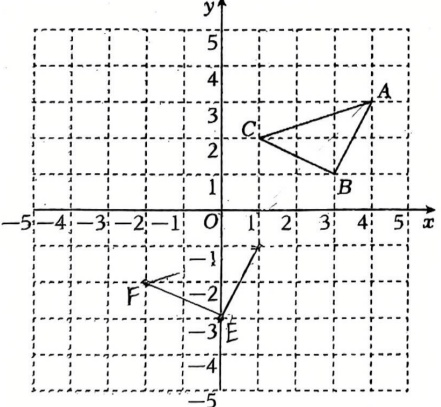

如图所示的平面直角坐标系中，$A(4, 3)$，$B(3, 1)$，$C(1, 2)$。将三角形 $ABC$ 平移后得到三角形 $DEF$，已知 $B$ 点平移的对应点为 $E$ 点 $(0, -3)$，$A$ 点与 $D$ 点对应，$C$ 点与 $F$ 点对应.

(1) 画出平移后的三角形 $DEF$，并写出点 $D$ 的坐标为 ___ ，点 $F$ 的坐标为 ___ .

(2) 求三角形 $ABC$ 的面积.

(3) 若点 $P(m, 0)$ 为 $x$ 轴上一动点，$S_{\text{三角形} PAB} = S_{\text{三角形} PDE}$，直接写出 $m$ 的值为 ___ .

> [!question]- 点击查看答案与解析
> 【答案】(1) $D(1, -1)$，$F(-2, -2)$；(2) $\frac{5}{2}$；(3) $m=2$
>
> 【考点】平移、面积 → [[【初中数学知识点体系-人教版】#9-2 坐标方法的简单应用]]
>
> 【解析】
> (1) $B(3, 1)\to E(0, -3)$，平移向量为 $(0-3, -3-1)=(-3, -4)$。
> $A(4, 3)\to D$：$D=(4-3, 3-4)=(1, -1)$。
> $C(1, 2)\to F$：$F=(1-3, 2-4)=(-2, -2)$。
>
> (2) 三角形 $ABC$ 的面积：
> 利用坐标公式：面积 $=\frac{1}{2}|x_1(y_2-y_3)+x_2(y_3-y_1)+x_3(y_1-y_2)|$
> $=\frac{1}{2}|4(1-2)+3(2-3)+1(3-1)|=\frac{1}{2}|-4-3+2|=\frac{5}{2}$。
>
> (3) $S_{\triangle PAB}=S_{\triangle PDE}$。
> $P(m, 0)$，$A(4, 3)$，$B(3, 1)$，$D(1, -1)$，$E(0, -3)$。
> $S_{\triangle PAB}=\frac{1}{2}|m(3-1)+4(1-0)+3(0-3)|=\frac{1}{2}|2m-5|$。
> $S_{\triangle PDE}=\frac{1}{2}|m(-1+3)+1(-3-0)+0|=\frac{1}{2}|2m-3|$。
>
> 由 $|2m-5|=|2m-3|$，得 $2m-5=-(2m-3)$（因为 $2m-5=2m-3$ 无解）。
> $4m=8$，$m=2$。
>
> 验证：$m=2$，$S_{\triangle PAB}=\frac{1}{2}$，$S_{\triangle PDE}=\frac{1}{2}$ ✓。
>
> 【易错点】平移的性质；三角形面积公式；绝对值方程。
