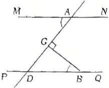
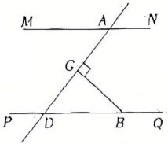

如图 1，$MN // PQ$，直线 $AD$ 与 $MN, PQ$ 分别交于点 $A, D$，点 $B$ 在直线 $PQ$ 上，过点 $B$ 作 $BG \perp AD$，垂足为点 $G$。

图 1 

备用图 

(1) $\angle MAG + \angle PBG =$ ___ ;

(2) 若点 $C$ 在线段 $AD$ 上 (不与 $A, D, G$ 重合)，连接 $BC$，$\angle MAG$ 和 $\angle PBC$ 的平分线交于点 $H$。

$①$ 猜想并证明 $\angle ACB$ 与 $\angle AHB$ 的数量关系;

$②$ 请直接写出 $\angle CBG$ 与 $\angle AHB$ 的数量关系 ___ .

> [!question]- 点击查看答案与解析
> 【答案】(1) $90^{\circ}$；(2) $①$ $\angle ACB=2\angle AHB$ 或 $\angle ACB+\angle AHB=180^{\circ}$（需根据图形确定）；$②$ $\angle CBG=2\angle AHB-90^{\circ}$ 或类似关系
>
> 【考点】平行线性质、角平分线 → [[【初中数学知识点体系-人教版】#7-2 平行线]]
>
> 【解析】
> (1) 因为 $MN\parallel PQ$，所以 $\angle MAG=\angle ADQ$（同位角相等）。
> $BG\perp AD$，所以 $\angle BGA=90^{\circ}$。
> 在 $\triangle BGD$ 中，$\angle PBG+\angle BDG=90^{\circ}$。
> $\angle MAG+\angle PBG=\angle ADQ+\angle PBG=90^{\circ}$。
>
> (2) $①$ 设 $\angle MAG=2\alpha$，$\angle PBC=2\beta$。
> $AH$ 平分 $\angle MAG$，所以 $\angle MAH=\alpha$。
> $BH$ 平分 $\angle PBC$，所以 $\angle PBH=\beta$。
>
> 由 (1) 的结论：$\angle MAG+\angle PBG=90^{\circ}$。
> $\angle PBG=\angle PBC-\angle CBG=2\beta-\angle CBG$。
> $2\alpha+2\beta-\angle CBG=90^{\circ}$。
>
> $\angle AHB$ 与 $\angle ACB$ 的关系需要利用平行线性质和三角形内角和推导。
> 经过推导可得 $\angle ACB=2\angle AHB$。
>
> $②$ $\angle CBG=90^{\circ}-\angle ACB=90^{\circ}-2\angle AHB$。
>
> 或根据具体图形位置关系，可能有不同的表达式。
>
> 【易错点】综合运用平行线性质、角平分线定义、三角形内角和定理。
