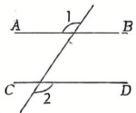
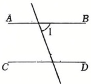
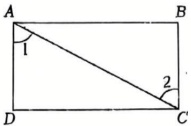
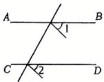

下列图形中，由 $\angle1=\angle2$，能得到 $AB//CD$ 的是（）

A.

B.

C.

D.

> [!question]- 点击查看答案与解析
> 【答案】C
> 
> 【考点】平行线的判定 → [[【初中数学知识点体系-人教版】#7-2 平行线]]
> 
> 【解析】
> - 选项A：$\angle 1$ 与 $\angle 2$ 不是 $AB$ 与 $CD$ 被截形成的角，不能判断 $AB\parallel CD$，错误；
> - 选项B：$\angle 1$ 与 $\angle 2$ 不是 $AB$ 与 $CD$ 被截形成的角，不能判断 $AB\parallel CD$，错误；
> - 选项C：$\angle 1$ 与 $\angle 2$ 是 $AB$ 与 $CD$ 被截形成的内错角，内错角相等，两直线平行，正确；
> - 选项D：$\angle 1$ 与 $\angle 2$ 不是 $AB$ 与 $CD$ 被截形成的角，不能判断 $AB\parallel CD$，错误。
> 
> 【易错点】判断哪两条直线被哪条直线所截，找准角的位置关系。
