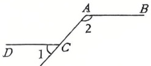

如图所示，$AB // CD$，若 $\angle1=36^{\circ}$，则 $\angle2$ 的度数是（）

A. $150^{\circ}$

B. $148^{\circ}$

C. $144^{\circ}$

D. $132^{\circ}$

> [!question]- 点击查看答案与解析
> 【答案】C
> 
> 【考点】平行线的性质、邻补角 → [[【初中数学知识点体系-人教版】#7-2 平行线]]
> 
> 【解析】
> 因为 $AB\parallel CD$，所以 $\angle 1$ 与 $\angle 2$ 是同旁内角，互补。
> $\angle 1+\angle 2=180^{\circ}$。
> $\angle 2=180^{\circ}-36^{\circ}=144^{\circ}$。
> 
> 【易错点】利用平行线性质，同旁内角互补。
