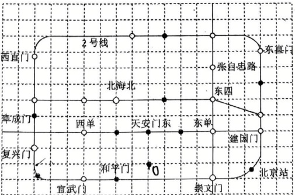

如图给出了北京地铁部分线路图中一些站点的分布情况，若崇文门站的坐标为 $(4,-1)$，东直门的坐标为 $(7,7)$，则复兴门站的坐标为（）

A. $(-1,-7)$

B. $(-7,1)$

C. $(-7,-1)$

D. $(1,7)$

> [!question]- 点击查看答案与解析
> 【答案】C
> 
> 【考点】平面直角坐标系的建立、点的坐标 → [[【初中数学知识点体系-人教版】#9-1 用坐标描述平面内点的位置]]
> 
> 【解析】
> 崇文门站 $(4, -1)$，东直门站 $(7, 7)$。
> 从崇文门到东直门：横坐标增加 3，纵坐标增加 8。
> 根据图中站点的相对位置，复兴门站在崇文门的左侧（横坐标更小），纵坐标相近。
> 从崇文门 $(4, -1)$ 向左移动约 11 个单位，到达复兴门 $(-7, -1)$。
> 
> 【易错点】根据已知两点确定坐标系，判断其他点的位置。
