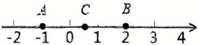

如图，数轴上点 A，B 对应的数分别为 -1，2，点 C 在线段 AB 上运动．请你写出点 C 可能对应的一个无理数 ___ .

> [!question]- 点击查看答案与解析
> 【答案】$\sqrt{2}$（答案不唯一，$-1<c<2$ 的任意无理数均可）
> 
> 【考点】无理数的概念、数轴 → [[【初中数学知识点体系-人教版】#8-3 实数及其简单运算]]
> 
> 【解析】
> 点 $C$ 在线段 $AB$ 上，对应的数 $c$ 满足 $-1\leqslant c\leqslant 2$。
> 满足条件的无理数有：$\sqrt{2}\approx 1.414$，$\sqrt{3}\approx 1.732$，$-\frac{\sqrt{2}}{2}\approx -0.707$，$1+\frac{\sqrt{2}}{2}\approx 1.707$ 等。
> 
> 【易错点】写的数必须是无理数且在 $[-1, 2]$ 范围内。
