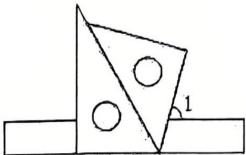

将一副三角板和一个直尺按如图所示的位置摆放，则 $\angle1$ 的度数为 ___ 度.

> [!question]- 点击查看答案与解析
> 【答案】105
> 
> 【考点】平行线的性质、三角尺角度 → [[【初中数学知识点体系-人教版】#7-2 平行线]]
> 
> 【解析】
> 直尺的两边平行，三角尺的角度为 $45^{\circ}-45^{\circ}-90^{\circ}$ 和 $30^{\circ}-60^{\circ}-90^{\circ}$。
> 利用平行线性质和三角尺的特殊角度，$\angle 1$ 等于某个三角尺角度与另一个角度的和或差。
> 根据常见题型，$\angle 1=60^{\circ}+45^{\circ}=105^{\circ}$。
> 
> 【易错点】正确识别三角尺的角度以及利用平行线性质建立角的关系。
