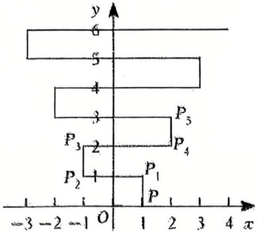

如图，在平面直角坐标系上有个点 $P(1,0)$，点 P 第 1 次向上跳动 1 个单位至点 $P_{1}(1,1)$，紧接着第 2 次向左跳动 2 个单位至点 $P_{2}(-1,1)$，第 3 次向上跳动 1 个单位，第 4 次向右跳动 3 个单位，第 5 次又向上跳动 1 个单位，第 6 次向左跳动 4 个单位，…依此规律跳动下去，$P_{7}$ 的坐标是 ___ ，点 P 第 2023 次跳动至 $P_{2023}$ 的坐标是 ___ .

> [!question]- 点击查看答案与解析
> 【答案】$(-2, 4)$；$(-506, 1012)$
> 
> 【考点】点的坐标规律 → [[【初中数学知识点体系-人教版】#9-2 坐标方法的简单应用]]
> 
> 【解析】
> 观察运动规律：
> $P_0(1, 0)$。
> 第 1 次：向上 1 个单位，$P_1(1, 1)$。
> 第 2 次：向左 2 个单位，$P_2(-1, 1)$。
> 第 3 次：向上 1 个单位，$P_3(-1, 2)$。
> 第 4 次：向右 3 个单位，$P_4(2, 2)$。
> 第 5 次：向上 1 个单位，$P_5(2, 3)$。
> 第 6 次：向左 4 个单位，$P_6(-2, 3)$。
> 第 7 次：向上 1 个单位，$P_7(-2, 4)$。
> 
> 纵坐标：每 2 次跳动增加 1，第 $n$ 次跳动后的纵坐标为 $\lceil\frac{n}{2}\rceil$。
> 第 2023 次：纵坐标为 $\lceil\frac{2023}{2}\rceil=1012$。
> 
> 横坐标：偶数次跳动后的横坐标 $x_{2k}$：
> $x_2=-1$，$x_4=2$，$x_6=-2$，$x_8=3$，$\cdots$。
> $k$ 为奇数时：$x_{2k}=-\frac{k+1}{2}$。
> $k$ 为偶数时：$x_{2k}=\frac{k}{2}+1$。
> 
> 第 2022 次：$k=1011$（奇数），$x_{2022}=-\frac{1011+1}{2}=-506$。
> 第 2023 次（向上跳动，横坐标不变）：$x_{2023}=-506$。
> 
> 所以 $P_{2023}(-506, 1012)$。
> 
> 【易错点】观察横纵坐标的变化规律，注意奇偶次跳动的不同特征。
