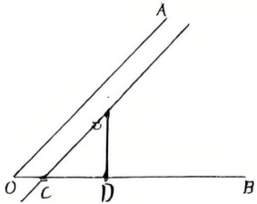

已知：$\angle AOB$ 及 $\angle AOB$ 内部一点 $P$.

(1) $①$ 过点 $P$ 作直线 $PD \perp OB$ 于点 $D$；$②$ 过点 $P$ 作直线 $PC // OA$ 交 $OB$ 于点 $C$；

(2) 比较线段 $PC$ 与线段 $PD$ 的大小：$PC$ ___ $PD$，理由是 ___ .

> [!question]- 点击查看答案与解析
> 【答案】(1) 略；(2) $>$；垂线段最短
> 
> 【考点】尺规作图、垂线段最短 → [[【初中数学知识点体系-人教版】#7-1 相交线]]
> 
> 【解析】
> (1) $①$ 过点 $P$ 作 $OB$ 的垂线，垂足为 $D$。
> $②$ 过点 $P$ 作 $OA$ 的平行线，交 $OB$ 于点 $C$。
> 
> (2) $PC>PD$，依据是：垂线段最短（点 $P$ 到直线 $OB$ 的距离 $PD$ 小于斜线段 $PC$）。
> 
> 【易错点】垂线段最短的应用。
