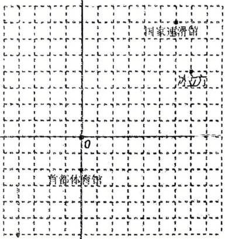

如图是北京冬奥会三个比赛场馆位置的平面示意图，图中小方格都是边长为 1 个单位长度的正方形，其中首都体育馆的坐标为 $(0,-2)$，国家速滑馆的坐标为 $(6,7)$ .

（1）请在图中画出平面直角坐标系，并写出冰立方的坐标：
（2）若五棵松体育中心的坐标为 $(-4,-6)$，请在坐标系中用点 $P$ 表示它的位置 .

> [!question]- 点击查看答案与解析
> 【答案】(1) 冰立方的坐标为 $(5, 1)$；(2) 略
> 
> 【考点】平面直角坐标系的建立、点的坐标 → [[【初中数学知识点体系-人教版】#9-1 用坐标描述平面内点的位置]]
> 
> 【解析】
> (1) 根据首都体育馆 $(0, -2)$ 和国家速滑馆 $(6, 7)$ 确定坐标系的原点和单位长度。
> 冰立方在图中标记为 $D$，从首都体育馆向右 5 格、向上 3 格，坐标为 $(5, 1)$。
> 
> (2) 五棵松体育中心 $(-4, -6)$ 在首都体育馆 $(0, -2)$ 的左下方 4 格、下方 4 格的位置。
> 
> 【易错点】根据已知点确定坐标系，判断其他点的位置。
